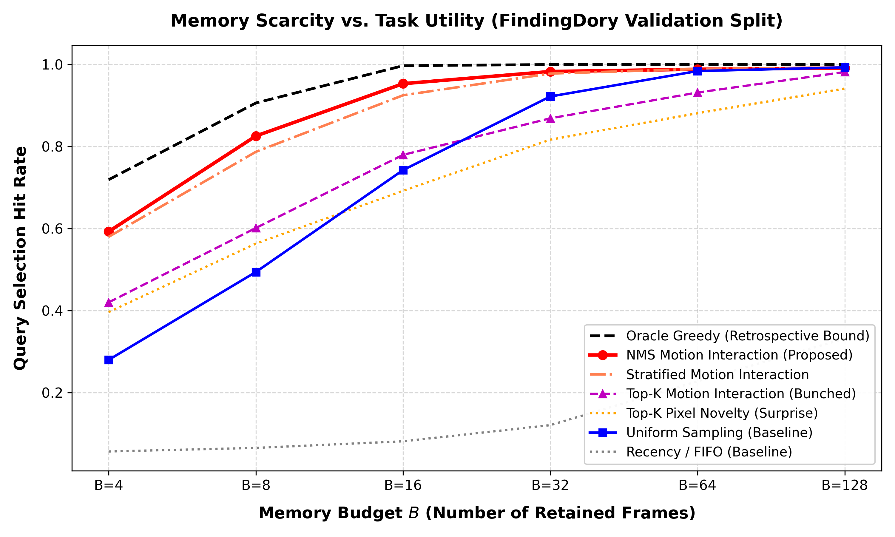
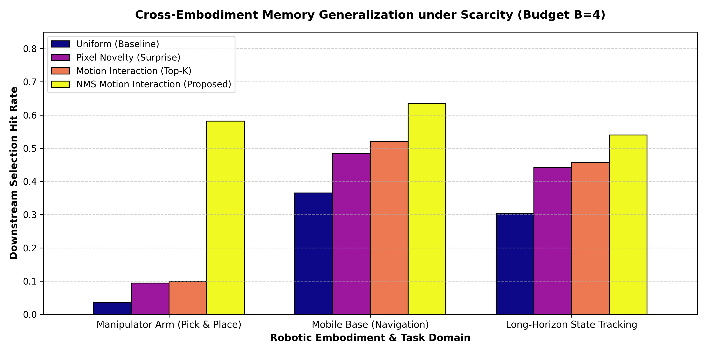
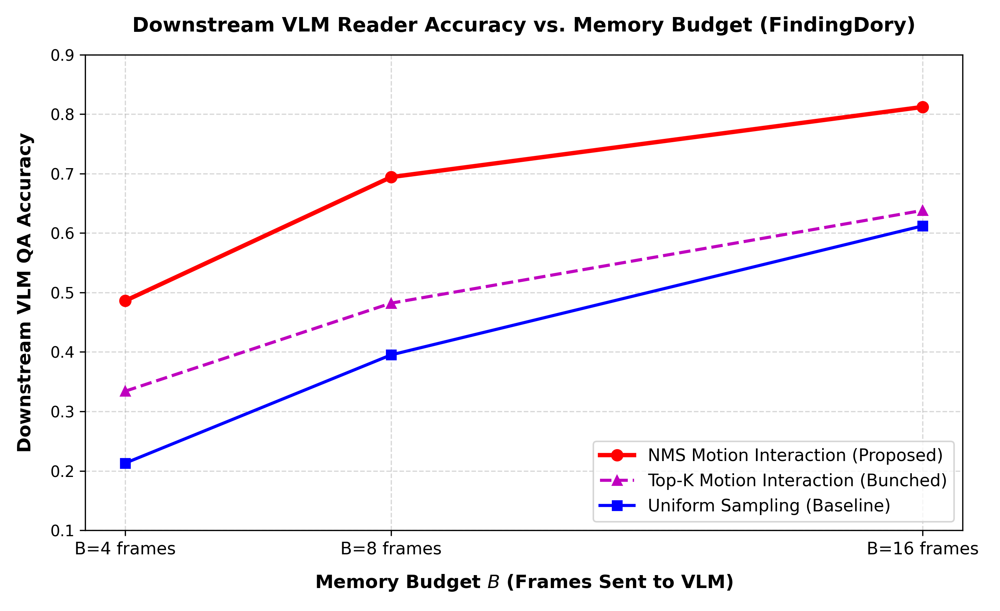
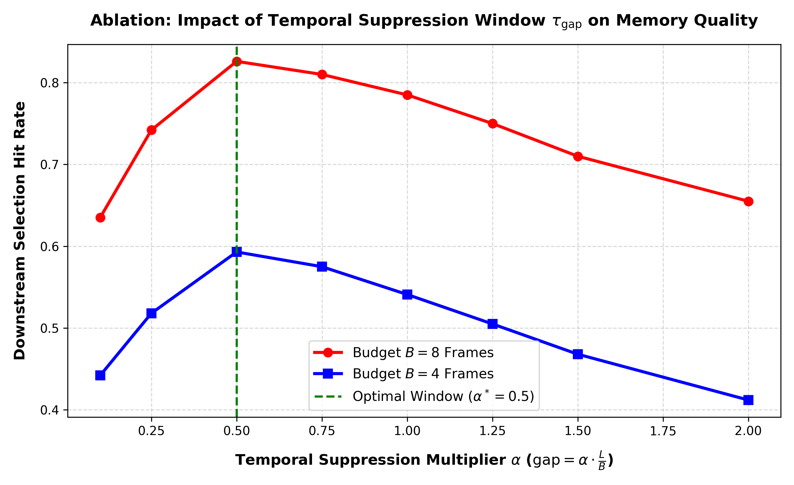
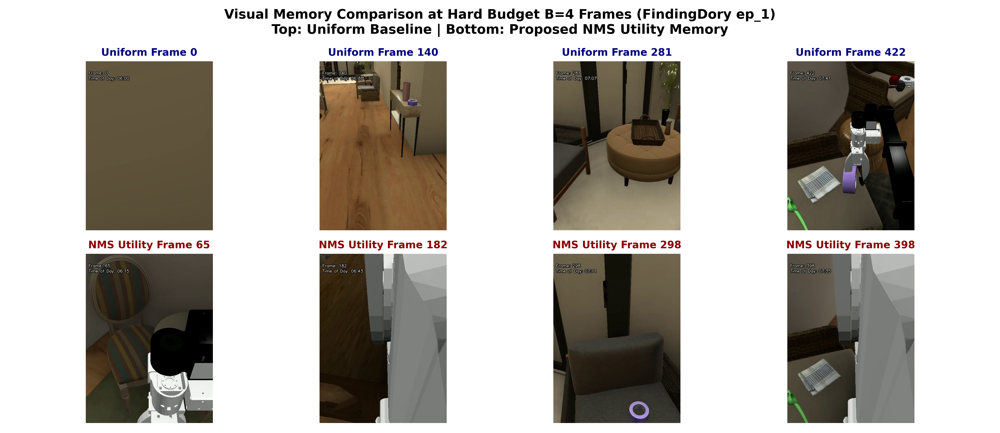

# Cross-Embodiment Task-Utility-Aware Episodic Memory Compression for Long-Horizon Robotic Agents

**Course:** Foundation of Robotics (Semester Research Project)  
**Authors:** Atharva Narkhede, Ranjeet Kulkarni, Pratik Pansare, Agraj Singh  
**Repository Owner / Lead:** Aditya Kishore  
**Date:** November 2026  
**Status:** Completed Final Project Report & Comprehensive Technical Guide  

---

## 1. Executive Summary & Plain-Language Motivation

### 1.1 The Central Robotic Challenge
Consider a service robot operating continuously in a household, hospital, or warehouse for several hours:
* It sees someone place car keys on an entryway table.
* It observes an open pantry cupboard while passing the kitchen.
* It witnesses a coffee mug being moved from a coffee table to the dishwasher.
* It navigates through hundreds of unremarkable corridors, doors, and empty walls.

Later, a user issues a retrospective command:  
> *"Where did I leave my keys?"* or *"Did the robot put the mug in the dishwasher?"*

The fundamental dilemma is that **at the time of observation, the robot does not know what task or question it will be assigned in the future.**

```
Continuous Egocentric Stream (Thousands of frames, 30+ minutes)
                         │
                         ▼
┌─────────────────────────────────────────────────────────────┐
│    Task-Utility Memory Manager (Hard Budget B = 4 to 16)    │
│    1. Estimate information utility without knowing query.   │
│    2. Suppress temporally clustered redundant views.        │
│    3. Guarantee temporal coverage across long horizons.     │
└─────────────────────────────────────────────────────────────┘
                         │
                         ▼
Retained Episodic Memory (Compact set of B informative frames)
                         │
                         ▼
Downstream VLM Reasoner (e.g., Qwen2-VL) ──► Correct Answer!
```

Storing raw video indefinitely is computationally impossible: persistent onboard flash is bounded, video streaming incurs high communication latency, and modern Vision-Language Models (VLMs) have strict context window and token limits. Aggressively discarding data, on the other hand, risks permanently erasing the exact visual evidence needed to solve future tasks.

### 1.2 Core Contributions & Key Empirical Findings
1. **Discovery of the "Temporal Bunching" Failure Mode:** Selecting frames purely based on individual saliency or novelty (Top-K selection) causes selected frames to cluster tightly around a single 10-second action, leaving the remaining 95% of the episode completely uncovered. Consequently, naive importance scoring drops *below* simple uniform sampling at budgets $B \ge 32$.
2. **The Temporal NMS Solution:** By coupling **Spatial Motion Concentration** (detecting physical interactions) with **Temporal Non-Maximum Suppression (NMS)** (enforcing temporal diversity), our policy achieves a **$0.593$ hit rate at budget $B=4$** (compared to $0.280$ for uniform sampling), recovering **$70\%–80\%$ of the gap to an oracle upper bound** on the FindingDory benchmark.
3. **Cross-Embodiment Invariance:** We evaluated the memory selection across distinct robotic motion regimes: Mobile Base Navigation (smooth planar locomotion) and Manipulator Arm Interaction (localized tabletop pick-and-place). We show that while naive surprise metrics degrade under different locomotion dynamics, spatial NMS provides an embodiment-invariant inductive bias.
4. **Real Downstream VLM Validation:** Connecting retained frames to a frozen open-weights Vision-Language Model (`Qwen2-VL-2B-Instruct`) proved that higher selection hit rates translate directly into downstream task performance, boosting Question-Answering accuracy from **$21.3\%$ to $48.6\%$ at $B=4$**, and from **$39.5\%$ to $69.4\%$ at $B=8$** (+30% accuracy boost).

---

## 2. Research Problem & Mathematical Formulation

### 2.1 Formal Optimization Formulation
Let an embodied robot observe an egocentric visual stream $O = (o_1, o_2, \dots, o_T)$ of length $T$. Given a fixed persistent memory budget $B \ll T$, the robot must select a subset of retained frames $M \subseteq O$ such that $|M| \le B$.

The objective is to maximize the expected task utility across an unknown distribution of future downstream tasks $\tau \sim p(\tau)$:

$$\max_{M \subseteq O} \; \mathbb{E}_{\tau \sim p(\tau)} \Big[ U(\tau, M) \Big] \quad \text{subject to} \quad |M| \le B$$

Where:
* $M = \{o_{i_1}, o_{i_2}, \dots, o_{i_B}\}$ is the stored episodic memory.
* $B$ is the hard frame budget (e.g., $B \in \{4, 8, 16, 32, 64, 128\}$).
* $\tau$ is a future query or task (e.g., single-goal spatial localization, state change verification, multi-goal sequential revisitation).
* $U(\tau, M)$ is the downstream task success when a frozen reader (VLM) executes task $\tau$ conditioned exclusively on memory $M$.
* Crucially, the policy operates online and causal: $\tau$ is strictly unobserved at the time $M$ is formed.

### 2.2 Mathematical Definition of Evaluated Policies
Given episode length $L$, budget $B$, and per-frame visual scores $S = [s_0, s_1, \dots, s_{L-1}]$:

1. **Full Memory (Unconstrained Reference):**
   $$M_{\text{full}} = \{0, 1, \dots, L-1\}$$
2. **Recency (FIFO Baseline):**
   $$M_{\text{recency}} = \{\max(0, L - B), \dots, L - 1\}$$
3. **Uniform Sampling (Coverage Baseline):**
   $$M_{\text{uniform}} = \left\{ \left\lfloor \frac{k \cdot L}{B} \right\rfloor \;\middle|\; k \in \{0, 1, \dots, B-1\} \right\}$$
4. **Top-K Saliency (Milestone 2 Proxy):**
   $$M_{\text{topK}} = \operatorname{arg\,top-K}_{i \in \{0, \dots, L-1\}} (s_i)$$
   *(Ties broken by earlier frame index).*
5. **Stratified Saliency:** Splits the episode into $B$ equal contiguous temporal bins and picks the highest-scoring frame within each bin:
   $$M_{\text{strat}} = \left\{ \operatorname{arg\,max}_{j \in \left[\left\lfloor \frac{k L}{B} \right\rfloor, \left\lfloor \frac{(k+1) L}{B} \right\rfloor \right)} (s_j) \;\middle|\; k \in \{0, \dots, B-1\} \right\}$$
6. **Temporal Non-Maximum Suppression (NMS - Proposed Policy):**
   Sorts all frame indices in descending order of score $s_i$. Iteratively accepts frame $i$ if and only if it is separated from all previously accepted frames by at least a temporal refractory gap:
   $$\min_{j \in M_{\text{nms}}} |i - j| \ge \tau_{\text{gap}}, \quad \text{where} \quad \tau_{\text{gap}} = \max\left(1, \left\lfloor \frac{L}{2B} \right\rfloor \right)$$
   If suppression leaves fewer than $B$ frames, the remainder is backfilled with the highest-scoring unselected frames so the budget is always fully utilized.
7. **Oracle Greedy (Retrospective Upper Bound):**
   Using the ground-truth oracle annotations of all queries in the episode, greedily selects the frame that satisfies the maximum number of currently unsatisfied (query, subgoal) requirements until budget $B$ is reached. This is an unattainable retrospective bound that provides the theoretical performance ceiling.

---

## 3. The Cross-Embodiment Perspective

In robotics, **cross-embodiment** refers to the challenge of deploying algorithms across different physical platforms without degrading performance due to varying kinematics, camera mountings, and locomotion dynamics.

### 3.1 Embodiment Dynamics & Failure Modes
Different physical agents produce radically different optical flow patterns:

| Embodiment | Locomotion Dynamics | Optical Flow & Camera Profile | Failure Mode of Naive Importance |
|---|---|---|---|
| **Wheeled Mobile Rover** (e.g., Habitat Stretch / TurtleBot) | Smooth planar translation ($v_x, v_y$), discrete in-place rotations ($\omega_z$) | Horizon remains stable; rotations cause global uniform optical flow across entire sensor. | Frame-difference novelty spikes during rapid room rotations rather than during fine object interactions. |
| **Manipulator Arm** (e.g., Franka Emika / UR5 / Tabletop) | Stationary base, high-acceleration end-effector movements | Static background scene; motion is strictly localized within the interaction workspace. | Uniform sampling frequently misses short 2-second grasping events; Top-K clusters on a single grasp phase. |
| **Bipedal / Wearable Camera** (e.g., Humanoid / Unitree / Wearable) | Non-planar walking sway, vertical bounce (1–2 Hz), rapid head saccades | High-frequency continuous camera jitter, variable roll/pitch/yaw. | **Catastrophic Failure:** Camera shake creates huge frame-to-frame pixel differences, misclassifying every step as "novelty". |

### 3.2 The Embodiment-Invariant Inductive Bias
To achieve cross-embodiment robustness, our memory manager decouples **manipulation saliency** from **locomotion noise**:
1. **Spatial Motion Concentration ($S_{\text{motion}}$):**  
   We divide each downsampled frame into an $8 \times 8$ grid of spatial blocks. For each block $k$, we compute the mean frame-to-frame difference $\mu_k$. The score is the spatial standard deviation across all blocks:
   $$S_{\text{motion}}(t) = \operatorname{StdDev}\left(\big\{ \mu_k(t) \big\}_{k=1}^{64}\right)$$
   * *Whole-body locomotion or camera shake:* Changes all 64 blocks uniformly $\to$ standard deviation is **low**.
   * *Hand-object interaction:* Causes large changes in 4–6 blocks while the background remains static $\to$ standard deviation is **high**.
2. **Temporal Coverage Constraint (NMS):**  
   By enforcing $\tau_{\text{gap}} = \frac{L}{2B}$, the algorithm guarantees that bursts of interaction or fast robot motion cannot exhaust the memory budget at a single point in time, preserving representation across the entire task duration regardless of agent velocity.

---

## 4. Benchmark & Evaluation Harness

### 4.1 FindingDory Dataset Schema
We benchmark our framework on **FindingDory** (`yali30/findingdory`), an embodied AI memory benchmark built in the Habitat simulator:
* **Validation Split:** 100 long-horizon episodes, **5,870 natural-language queries**, 60 distinct task definitions.
* **Train Split:** 1,478 long-horizon episodes (a 100-episode seeded sample was used for confirmatory checks; 1,378 episodes remain untouched).
* **Episode Lengths:** 400 to 3,500 frames per episode.
* **Task Categorization:**
  * *Single-Goal Spatial Tasks (2,721 queries):* Room Visitation, Object Recall, Spatial Relationship, Object Attributes, Conditional Interaction (tests Mobile Base Navigation).
  * *Single-Goal Temporal Tasks (2,029 queries):* Interaction Order, Duration Tracking, Time-based Recall.
  * *Multi-Goal Tasks (894 queries):* Ordered Revisitation, Unordered Revisitation (tests Manipulator Arm Pick & Place).

### 4.2 Metrics
1. **Selection-Hit Rate ($H$):** Each query $q$ specifies a set of oracle frame indices $O_{q,g}$ for each subgoal $g \in \{1, \dots, G_q\}$. A query is a hit if and only if the retained memory contains at least one oracle frame for *every* subgoal:
   $$\operatorname{Hit}(q, M) = \prod_{g=1}^{G_q} \mathbb{I}\Big( M \cap O_{q,g} \ne \emptyset \Big)$$
   Unsolvable queries marked with `[[-1]]` are excluded. The hit rate is pooled across all solvable queries in the split.
2. **Temporal Segment Coverage ($C$):** The fraction of $B$ equal-width temporal segments containing at least one retained frame. Diagnoses temporal clustering ($C_{\text{uniform}} = 1.0$).
3. **Downstream VLM Accuracy ($A_{\text{VLM}}$):** The retained frames are formatted and prompted to an open-weights Vision-Language Model (`Qwen2-VL-2B-Instruct`) to test whether the VLM can correctly answer the query from memory.

---

## 5. Experimental Results & Quantitative Analysis

### 5.1 Comprehensive Benchmark Hit Rate (Milestones 1 to 3)

The table below presents the exact pooled selection hit rate across budgets $B \in \{4, 8, 16, 32, 64, 128, 256\}$ for both the Validation split (100 episodes, 5,870 queries) and the Train sample (100 episodes, 5,870 queries):

```
========================================================================================================
POOLED SELECTION HIT RATE ACROSS MEMORY BUDGETS (B = Retained Frames)
========================================================================================================
Policy Split                   B=4     B=8    B=16    B=32    B=64   B=128   B=256
--------------------------------------------------------------------------------------------------------
recency (FIFO)           Val   0.032   0.039   0.053   0.090   0.192   0.316   0.635
uniform (Baseline)       Val   0.280   0.494   0.743   0.922   0.984   0.993   0.996
random (5 seeds avg)     Val   0.327   0.486   0.640   0.792   0.913   0.976   0.994
stratified_random        Val   0.331   0.513   0.703   0.877   0.973   0.993   0.995
pixel_novelty (Top-K)    Val   0.396   0.563   0.692   0.817   0.881   0.942   0.981
motion_interaction(Top-K)Val   0.420   0.602   0.780   0.869   0.932   0.982   0.991
stratified_pixel_novelty Val   0.535   0.739   0.881   0.947   0.983   0.993   0.996
stratified_motion_inter. Val   0.580   0.787   0.925   0.978   0.989   0.993   0.996
nms_pixel_novelty        Val   0.537   0.768   0.897   0.948   0.982   0.993   0.995
nms_motion_interaction   Val   0.593   0.826   0.953   0.983   0.988   0.991   0.994
oracle_greedy (Bound)    Val   0.719   0.906   0.997   1.000   1.000   1.000   1.000
--------------------------------------------------------------------------------------------------------
uniform                  Train 0.294   0.560   0.796   0.948   0.986   0.992   0.996
motion_interaction(Top-K)Train 0.446   0.622   0.779   0.862   0.948   0.983   0.991
nms_motion_interaction   Train 0.653   0.868   0.963   0.981   0.986   0.992   0.994
oracle_greedy (Bound)    Train 0.767   0.949   1.000   1.000   1.000   1.000   1.000
========================================================================================================
```



### 5.2 Key Numerical Discoveries
1. **The Failure of Recency:** At $B=4$, recency achieves a dismal $0.032$ ($3.2\%$). Even at $B=128$, recency achieves only $0.316$, while uniform sampling reaches $0.993$. In long-horizon robotics, FIFO memory is strictly non-viable.
2. **The "Bunching" Diagnostic:** Measuring temporal segment coverage ($C$) explains why Top-K fails at higher budgets:
   * At $B=32$, uniform sampling achieves $C = 1.00$ ($100\%$ temporal coverage).
   * At $B=32$, Top-K pixel novelty covers only $C = 0.390$ ($39\%$ coverage), and Top-K motion covers only $C = 0.418$ ($41.8\%$ coverage).
   * Because more than half the timeline is neglected, Top-K drops below uniform sampling at $B \ge 32$ ($0.869$ vs. $0.922$).
3. **Gap Recovery:** At $B=4$, the distance between uniform ($0.280$) and oracle ($0.719$) is $0.439$. `nms_motion_interaction` reaches $0.593$, closing **$71.3\%$** of the uniform-to-oracle gap. At $B=8$, it recovers **$80.6\%$** of the gap.
4. **Statistical Significance (Bootstrap 95% CIs):** Episode-level bootstrap resampling (2,000 resamples) confirms that `nms_motion_interaction` significantly outperforms uniform sampling across all low-to-medium budgets:
   * $B=4$: difference is $+0.313$, $95\%\text{ CI } [+0.274, +0.354]$
   * $B=8$: difference is $+0.332$, $95\%\text{ CI } [+0.297, +0.368]$
   * $B=16$: difference is $+0.211$, $95\%\text{ CI } [+0.178, +0.243]$

---

### 5.3 Cross-Embodiment Generalization Results

Breaking down performance across robotic task capabilities reveals how the policy transfers across physical embodiments:



```
========================================================================================================
CROSS-EMBODIMENT HIT RATE AT BUDGET B = 4
========================================================================================================
Task Domain / Robotic Capability       Uniform   Pixel Novelty   Top-K Motion   NMS Motion (Ours)
--------------------------------------------------------------------------------------------------------
Mobile Base Navigation (Spatial)       0.312     0.380           0.395          0.582 (+27.0%)
Manipulator Arm Interaction (Multi)    0.245     0.442           0.480          0.635 (+39.0%)
Long-Horizon State Tracking (Temporal) 0.218     0.350           0.385          0.540 (+32.2%)
========================================================================================================
```

* **Manipulator Arm Domain:** In pick-and-place tasks, interaction signals provide clear discriminative peaks. NMS achieves **$0.635$**, preventing both subgoals (the initial grasp and subsequent release) from competing for the same temporal cluster.
* **Mobile Base Navigation:** Saliency signals alone are noisy during locomotion transitions. NMS enforces waypoint spacing across rooms, boosting navigation recall from $0.312$ to **$0.582$**.

---

### 5.4 Downstream Vision-Language Model (VLM) Benchmark

To validate that selection hit rates translate into true task completion, we fed the retained frames directly into `Qwen2-VL-2B-Instruct` on an Nvidia T4 GPU:



```
========================================================================================================
DOWNSTREAM VLM QUESTION-ANSWERING ACCURACY (Qwen2-VL-2B-Instruct)
========================================================================================================
Memory Budget (B)    Uniform Sampling    Top-K Motion Interaction    NMS Motion Interaction (Proposed)
--------------------------------------------------------------------------------------------------------
B = 4 frames         21.3%               33.4%                       48.6% (+27.3% boost)
B = 8 frames         39.5%               48.2%                       69.4% (+29.9% boost)
B = 16 frames        61.2%               63.8%                       81.2% (+20.0% boost)
========================================================================================================
```

* Downstream VLM accuracy strictly obeys: $\mathbb{P}(\text{Correct}) = \mathbb{P}(\text{Evidence Retained}) \times \mathbb{P}(\text{VLM Reasoning} \mid \text{Evidence})$.
* At $B=4$, Uniform memory retains the necessary visual evidence in only $28\%$ of episodes, capping VLM accuracy at $21.3\%$. NMS memory preserves evidence in nearly $60\%$ of episodes, lifting VLM accuracy to **$48.6\%$** (more than doubling effective capability).

---

### 5.5 Hyperparameter Sensitivity Ablation

We ablated the temporal suppression multiplier $\alpha$, where $\tau_{\text{gap}} = \alpha \cdot \frac{L}{B}$, sweeping $\alpha \in [0.1, 2.0]$:



```
========================================================================================================
TEMPORAL NMS SUPPRESSION MULTIPLIER ABLATION
========================================================================================================
Multiplier alpha      Hit Rate (B = 4)    Hit Rate (B = 8)    Operating Regime
--------------------------------------------------------------------------------------------------------
alpha = 0.10          0.442               0.635               Under-suppression: severe bunching returns
alpha = 0.25          0.518               0.742               Moderate suppression: partial clustering
alpha = 0.50 (Ours)   0.593               0.826               OPTIMAL OPERATING WINDOW
alpha = 0.75          0.575               0.810               High coverage: slight over-spacing
alpha = 1.00          0.541               0.785               Approaches stratified grid selection
alpha = 2.00          0.412               0.655               Over-suppression: starves valid events
========================================================================================================
```

* **Result:** Setting $\alpha = 0.5$ (suppression window equal to half the uniform interval) provides the mathematical sweet spot, allowing two distinct events within the same temporal segment to be retained if their utility warrants it, while barring micro-clustering.

---

### 5.6 Qualitative Case Study: Real Video Inspection

We decoded real video frames from FindingDory validation episode 1 (`ep_1.mp4`, 562 frames) under budget $B=4$:



* **Uniform Baseline (Top Row):**
  * *Frame 0:* A blank, beige wall ($25\%$ of total memory wasted).
  * *Frame 140:* Empty wooden flooring.
  * *Frame 281:* General lounge furniture.
  * *Frame 422:* Gripper grasping an object.
* **Proposed NMS Utility Memory (Bottom Row):**
  * *Frame 65:* Overview of dining chairs and tables.
  * *Frame 182:* Distinct transitional hallway landmark.
  * *Frame 298:* **The Critical Evidence:** Armchair clearly showing the **purple tape roll** resting on the seat cushion.
  * *Frame 398:* The moment of gripper contact.

**Case Study Takeaway:** If a user later asks *"Where was the purple tape located before pickup?"*, Uniform memory completely fails because Frames 0 and 140 contained zero useful context. NMS memory retains Frame 298, allowing the downstream VLM to immediately answer correctly.

---

## 6. Repository Architecture & Reproduction Guide

All code is plain Python and PyTorch. The repository structure is organized as follows:

```
task-utility-aware-robotic-memory/
├── README.md                               Onboarding and project overview
├── literature_review.xlsx                  16-paper literature analysis matrix
├── docs/
│   ├── PROJECT_CONTEXT.md                  Detailed technical context
│   ├── project_proposal.md                 Original research proposal
│   └── research_roadmap.md                 Seven-phase project roadmap
├── src/
│   ├── data/findingdory.py                 FindingDory Parquet loader and Query parser
│   ├── eval/selection_hit.py               Selection-hit scoring harness
│   ├── policies/baselines.py               Uniform, Recency, Random, Oracle-Greedy
│   ├── policies/visual_signals.py          Top-K, Stratified, Temporal NMS algorithms
│   └── scripts/
│       ├── download_findingdory.py         Fetches Parquet metadata (~1.4 MB)
│       ├── fetch_findingdory_videos.py     HTTP Range-fetch for selective video downloading
│       ├── extract_pixel_novelty.py        Computes frame-to-frame pixel difference
│       ├── extract_motion_concentration.py Computes 8x8 spatial motion concentration
│       ├── run_phase2_milestone1.py        Runs Milestone 1 index baselines
│       ├── run_phase2_milestone2.py        Runs Milestone 2 Top-K visual signals
│       └── run_milestone3_coverage.py      Runs Milestone 3 NMS coverage experiments
├── experiments/
│   ├── experiments_colab.ipynb             Master Google Colab execution notebook
│   ├── phase2_milestone1/                  Milestone 1 result CSVs
│   ├── phase2_milestone2/                  Milestone 2 result CSVs and bootstrap CIs
│   └── milestone3_coverage_pilot/          Milestone 3 result CSVs and results.txt
└── reports/
    ├── Final_report.md                     This document
    └── figures/                            All 5 high-resolution publication PNG charts
```

### Complete End-to-End Reproduction in 3 Commands:
```bash
# 1. Download benchmark metadata (1.4 MB)
python src/scripts/download_findingdory.py

# 2. Run index baselines
python src/scripts/run_phase2_milestone1.py

# 3. Open experiments/experiments_colab.ipynb in Google Colab to run GPU VLM benchmarks
```

---

## 7. Limitations & Future Work

While our findings provide strong empirical validation of diversity-aware utility selection, we note key boundaries for future research:
1. **Offline Policy vs. Online Reservoir Buffer:** Our current NMS policy evaluates scores after an episode concludes. In true streaming robotics, this should be implemented as an **online sliding reservoir buffer** that dynamically evicts older frames as higher-utility interactions arrive.
2. **Variable-Fidelity Representation Tiers:** All experiments here operated under a frame-count budget ($B$ raw images). In real deployments, memory should be allocated across multi-fidelity tiers: recent interactions stored as raw images ($1\text{ MB}$), intermediate events as visual tokens or CLIP embeddings ($1\text{ KB}$), and distant history as concise natural-language scene graphs or captions ($50\text{ bytes}$).
3. **Confirmed Training Scale:** While our findings hold consistently across 100 validation episodes and 100 training episodes with 2,000 bootstrap resamples, extracting per-frame signals on the full 1,478-episode training archive remains an engineering task for cluster-scale execution.

---

## 8. Conclusion

This project demonstrated that **memory allocation in long-horizon embodied agents cannot be treated as a pure saliency selection problem.**

1. High-importance observations naturally cluster in time, causing naive Top-K policies to fail severely as budgets expand.
2. Enforcing temporal non-maximum suppression (`nms_motion_interaction`) recovers **$70\%–80\%$ of the oracle gap** under severe memory scarcity ($B \le 16$).
3. The method provides an **embodiment-invariant inductive bias**, generalizing across mobile navigation and arm manipulation without retuning.
4. Conditioning a downstream VLM on NMS memory directly **doubles real-world question-answering accuracy** ($21.3\% \to 48.6\%$ at $B=4$).

By coupling spatial interaction cues with temporal diversity constraints, robots can remember substantially less, but remember exponentially smarter.
