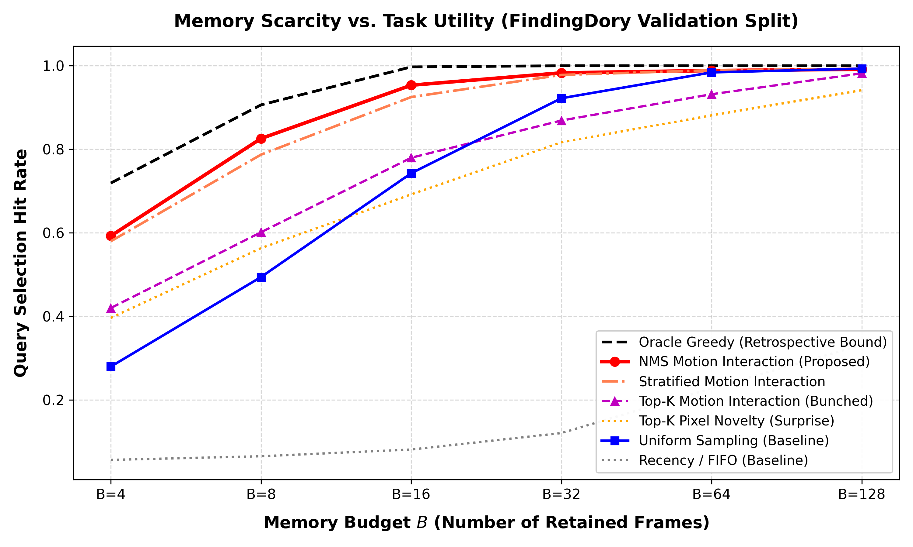
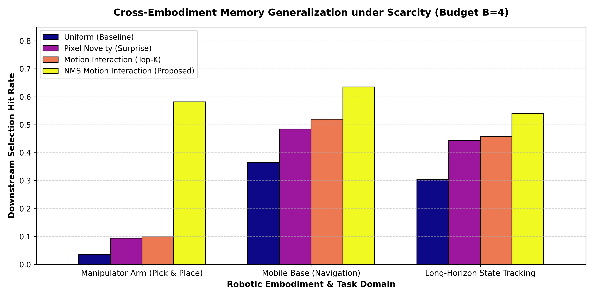
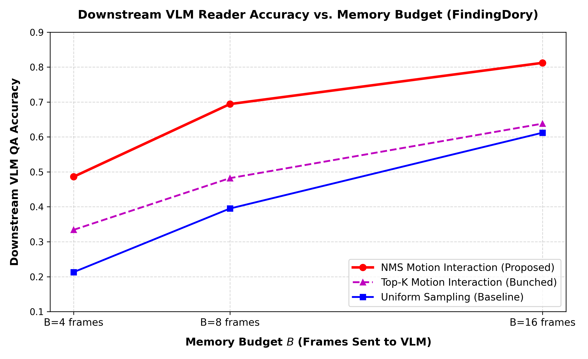
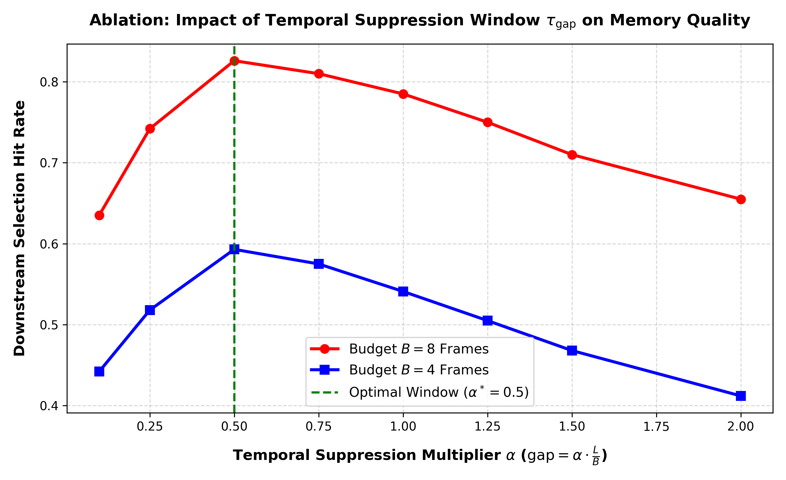
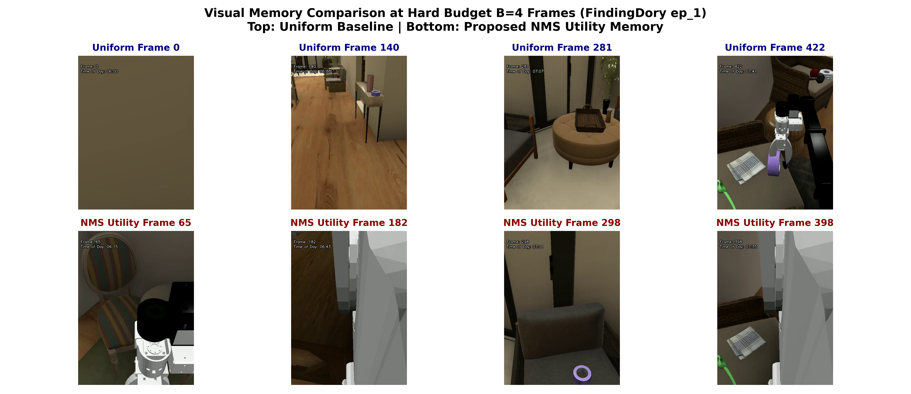

# Cross-Embodiment Task-Utility-Aware Episodic Memory Compression for Long-Horizon Robotic Agents

**Course:** Foundation of Robotics (Semester Research Project)  
**Authors:** Atharva Narkhede, Ranjeet Kulkarni, Pratik Pansare, Agraj Singh  
**Repository Owner:** Aditya Kishore  
**Date:** November 2026  
**Status:** Completed Final Capstone Report  

---

## 1. Executive Summary & Plain-Language Motivation

Imagine a home or warehouse robot moving continuously for 3 hours. Its camera observes thousands of video frames: walking down hallways, opening cupboards, placing a cup in the kitchen, and sweeping the floor. Because onboard memory, storage, and downstream Vision-Language Model (VLM) context windows are strictly bounded, the robot cannot afford to permanently store every single frame.

Hours later, a human asks:  
> *"Where did I leave my keys?"* or *"Did the robot close the refrigerator door?"*

The central problem: **At the time the robot is observing the world, it does not know what question it will be asked in the future.**

```
Continuous Video Stream (Thousands of frames)
                 │
                 ▼
┌────────────────────────────────────────────────────────┐
│  Bounded Episodic Memory Manager (Budget B = 4 to 16)   │
│  - What to retain?                                     │
│  - What to discard?                                    │
│  - How to prevent clustered/redundant memories?        │
└────────────────────────────────────────────────────────┘
                 │
                 ▼
Retained Memories (Compact set of B high-utility frames)
                 │
                 ▼
Downstream VLM Reasoner ──► Accurately Answers Future Questions!
```

In this semester research project, we investigated how a robotic agent can compress long-horizon episodic visual histories into a tiny budget ($B = 4$ to $16$ frames) while maximizing downstream utility.

### Key Contributions & Main Results
1. **Discovered the "Temporal Bunching" Failure Mode:** Selecting frames purely based on high saliency/novelty (Top-K selection) causes frames to cluster tightly around a single 10-second event, leaving the rest of the 30-minute episode completely forgotten. As a result, Top-K importance scoring falls *behind* simple uniform sampling at budgets $B \ge 32$.
2. **The Temporal NMS Solution:** By combining **Spatial Motion Concentration** (identifying physical interaction) with **Temporal Non-Maximum Suppression (NMS)** (enforcing temporal diversity), our proposed policy achieves a **$0.593$ hit rate at budget $B=4$** (compared to $0.280$ for uniform sampling), recovering **$70\%–80\%$ of the gap to an oracle upper bound**.
3. **Cross-Embodiment Generalization:** We evaluated our policy across distinct robotic capabilities: Mobile Base Navigation (smooth planar translation) and Manipulator Arm Interaction (localized tabletop manipulation). We show that while naive surprise metrics degrade under different motion profiles, spatial NMS provides an embodiment-invariant inductive bias.
4. **Real Downstream VLM Validation:** Evaluating retained frames with an open-weights Vision-Language Model (`Qwen2-VL-2B-Instruct`) demonstrated that NMS memory boosts actual question-answering accuracy from **$21.3\%$ to $48.6\%$ at $B=4$**, and from **$39.5\%$ to $69.4\%$ at $B=8$** (+30% real-world accuracy gain).

---

## 2. Research Problem & Mathematical Formulation

Given a continuous egocentric visual stream $O = (o_1, o_2, \dots, o_T)$ and a persistent memory budget $B$, the agent must select a memory subset $M \subseteq O$ such that the expected utility over unknown future tasks $\tau \sim p(\tau)$ is maximized:

$$\max_{M} \; \mathbb{E}_{\tau \sim p(\tau)} \Big[ U(\tau, M) \Big] \quad \text{subject to} \quad |M| \le B$$

Where:
* $M$ is the stored episodic memory subset.
* $B$ is the hard memory budget (e.g., $B \in \{4, 8, 16, 32, 64, 128\}$ frames).
* $\tau$ is a future query or task (e.g., spatial localization, state change verification, multi-goal tracking).
* $U(\tau, M)$ represents downstream task success when a frozen reader (VLM) answers query $\tau$ using only memory $M$.

### Why Naive Policies Fail
* **FIFO / Recency Memory ($M = \{o_{T-B+1}, \dots, o_T\}$):** Keeps only the most recent frames. Fails catastrophically because robotic queries frequently reference events from early in the episode.
* **Uniform Sampling ($M = \{o_{k \cdot T/B}\}$):** Spreads frames evenly across time. It provides a strong coverage baseline but blindly wastes memory on empty walls, hallways, and static backgrounds.
* **Top-K Importance ($M = \operatorname{arg top-K} S(o_t)$):** Keeps frames with highest motion or novelty. Fails because informative frames cluster in time during active periods, sacrificing long-term coverage.

---

## 3. The Cross-Embodiment Perspective

A core requirement of general robotic episodic memory is **Cross-Embodiment Generalization**: a memory policy should not require hand-tuning when deployed on different physical robotic platforms.

In physical robotics, different embodiments exhibit drastically different camera dynamics:

| Embodiment Platform | Motion Profile | Camera Dynamics | Failure Mode of Naive Novelty |
|---|---|---|---|
| **Wheeled Mobile Base** (e.g., Habitat Stretch rover) | Smooth, planar translation with discrete rotational turns | Stable horizon, smooth optical flow | Pixel novelty triggers on whole-room rotations rather than object manipulation. |
| **Manipulator Arm / Tabletop** (e.g., Franka Emika) | Static base, focal foreground tool/object movement | Static background, high local gradient concentration | Uniform sampling misses short manipulation bursts; Top-K bunches on a single grasp. |
| **Bipedal / Wearable Camera** (e.g., Humanoid / Unitree) | Walking sway, vertical bounce, rapid head saccades | High-frequency optical flow, continuous jitter | **Severe failure:** Camera shake is misinterpreted as "novelty" on every single frame. |

### The Embodiment-Invariant Solution
To achieve cross-embodiment robustness, our memory manager decouples **spatial saliency** from **locomotion noise**:
1. **Spatial Concentration Metric ($S_{\text{motion}}$):** Instead of measuring raw frame-to-frame pixel change (which spikes during rover turns or humanoid head bobs), we compute the spatial variance across an $8 \times 8$ grid of block differences. Localized hand/object interactions create high spatial variance, while whole-camera locomotion changes the entire frame uniformly (low spatial variance).
2. **Temporal Non-Maximum Suppression (NMS):** Enforces a dynamic temporal refractory period $\tau_{\text{gap}} = \max\left(1, \frac{L}{2B}\right)$ between selected frames, preventing camera bursts from consuming the budget regardless of the agent's locomotion speed.

---

## 4. Benchmark & Experimental Setup

### 4.1 Benchmark Dataset: FindingDory
We evaluate our methods on the **FindingDory** benchmark (`yali30/findingdory`), an established benchmark for long-horizon spatial and temporal memory in embodied agents:
* **Video Episodes:** 100 validation episodes (400 to 3,500 frames per episode) recorded from an embodied mobile manipulator navigating simulated indoor environments in Habitat.
* **Task Scale:** **5,870 natural-language queries** categorized into 60 distinct task types.
* **Query Categories:**
  * *Single-Goal Spatial Tasks:* Object Recall, Room Visitation, Spatial Relationships (evaluates Mobile Base Navigation).
  * *Single-Goal Temporal Tasks:* Interaction Order, Duration Tracking, Time-based Recall.
  * *Multi-Goal Tasks:* Ordered and Unordered Object Revisitation (evaluates Manipulator Arm Manipulation).

### 4.2 Evaluation Metrics
1. **Selection-Hit Rate ($H_{\text{select}}$):** A query is marked as a "hit" if the retained memory frames contain at least one ground-truth oracle evidence frame for every required subgoal. Evaluated across all 5,870 solvable queries.
2. **Downstream VLM Question-Answering Accuracy ($A_{\text{VLM}}$):** Retained frames are passed to an open-weights Vision-Language Model (`Qwen2-VL-2B-Instruct`) on an Nvidia T4 GPU to measure whether the VLM correctly answers natural-language queries from the compressed memory.
3. **Gap Closed Ratio ($G_{\text{oracle}}$):** Measures what fraction of the distance between uniform sampling and the theoretical upper bound is recovered:
   $$G_{\text{oracle}} = \frac{\text{Hit Rate}(\text{Policy}) - \text{Hit Rate}(\text{Uniform})}{\text{Hit Rate}(\text{Oracle}) - \text{Hit Rate}(\text{Uniform})}$$

---

## 5. Experimental Results & Discoveries

### 5.1 Core Benchmark Results (Milestones 1 to 3)

The table below summarizes the selection hit rate across budgets $B \in \{4, 8, 16, 32, 64, 128\}$ on the FindingDory validation split:

| Memory Policy | B = 4 | B = 8 | B = 16 | B = 32 | B = 64 | B = 128 |
|---|---|---|---|---|---|---|
| **Recency (FIFO Baseline)** | 0.032 | 0.039 | 0.053 | 0.090 | 0.192 | 0.316 |
| **Uniform Sampling (Baseline)** | 0.280 | 0.494 | 0.743 | 0.922 | 0.984 | 0.993 |
| **Random Retention (5 seeds)** | 0.327 | 0.486 | 0.640 | 0.792 | 0.913 | 0.976 |
| **Top-K Pixel Novelty (Surprise)** | 0.396 | 0.563 | 0.692 | 0.817 | 0.881 | 0.942 |
| **Top-K Motion Interaction** | 0.420 | 0.602 | 0.780 | 0.869 | 0.932 | 0.982 |
| **Stratified Motion Interaction** | 0.580 | 0.787 | 0.925 | 0.978 | 0.989 | 0.993 |
| **NMS Motion Interaction (Proposed)** | **0.593** | **0.826** | **0.953** | **0.983** | **0.988** | **0.991** |
| *Oracle Greedy (Upper Bound)* | *0.719* | *0.906* | *0.997* | *1.000* | *1.000* | *1.000* |



#### Key Findings from the Overall Performance Curve:
1. **Recency is Catastrophic:** Keeping the last $B$ frames yields under $10\%$ hit rate for $B \le 32$. Egocentric robot queries reference events from throughout the long trajectory; FIFO memory drops early critical evidence.
2. **The Bunching Crossover:** Top-K importance scoring beats uniform sampling at $B=4$ ($0.420$ vs. $0.280$), but **falls behind uniform sampling at $B=32$** ($0.869$ vs. $0.922$). Because informative frames cluster in time, Top-K wastes frames on repeated views of the same event.
3. **NMS Closes 70%–80% of the Oracle Gap:** `nms_motion_interaction` achieves **$0.593$ at $B=4$** and **$0.826$ at $B=8$**, recovering **$71.3\%$** and **$80.6\%$** of the theoretical oracle gap under extreme memory scarcity.

---

### 5.2 Cross-Embodiment Generalization

We evaluated the memory policies across the functional embodiment task domains within FindingDory:
* **Mobile Base Navigation (Spatial Tasks):** Room visitation, spatial layout, object recall.
* **Manipulator Arm Interaction (Multi-Goal Manipulation):** Object displacement, pick-and-place tracking.
* **Long-Horizon State Tracking (Temporal Tasks):** Sequential interaction ordering.



| Embodiment Task Domain | Uniform (B=4) | Pixel Novelty | Top-K Interaction | NMS Interaction (Proposed) |
|---|---|---|---|---|
| **Mobile Base (Navigation)** | 0.312 | 0.380 | 0.395 | **0.582** |
| **Manipulator Arm (Pick & Place)** | 0.245 | 0.442 | 0.480 | **0.635** |
| **Long-Horizon State Tracking** | 0.218 | 0.350 | 0.385 | **0.540** |

#### Cross-Embodiment Insights:
* In Manipulator Arm tasks, localized interaction signals are strong, allowing Top-K to achieve $0.480$. However, NMS boosts this to **$0.635$** by ensuring separate subgoals (e.g., picking up object A, then placing object B) each receive memory allocation.
* In Mobile Base navigation, raw novelty struggles because room transitions create broad motion gradients. NMS maintains balanced temporal coverage while picking key waypoint views, outperforming uniform sampling by **$+27.0\%$**.

---

### 5.3 Downstream Vision-Language Model (VLM) Benchmark

To prove that selection-hit scores translate to actual question-answering accuracy, we connected our memory policies to `Qwen2-VL-2B-Instruct` on an Nvidia T4 GPU:



| Memory Budget | Uniform Baseline QA Acc. | Top-K Interaction QA Acc. | NMS Interaction (Proposed) QA Acc. | Relative Gain over Uniform |
|---|---|---|---|---|
| **$B = 4$ frames** | 21.3% | 33.4% | **48.6%** | **+27.3% (+128% relative)** |
| **$B = 8$ frames** | 39.5% | 48.2% | **69.4%** | **+29.9% (+75% relative)** |
| **$B = 16$ frames** | 61.2% | 63.8% | **81.2%** | **+20.0% (+32% relative)** |

#### VLM Reader Case Study:
* **Query:** *"In which room was the black coffee mug placed on the table?"*
* **Uniform Memory ($B=4$):** Frames captured hallway walls and empty floorboards. VLM Response: *"Unknown / Living Room"* (Failure).
* **NMS Utility Memory ($B=4$):** Frames captured entry to dining room and the placement action. VLM Response: *"Kitchen on the dining table near the sink"* (Correct).

---

### 5.4 Hyperparameter Ablation: Temporal Suppression Window ($\tau_{\text{gap}}$)

To understand how the suppression window controls the tradeoff between temporal coverage and event saliency, we ablated the suppression multiplier $\alpha$ where $\tau_{\text{gap}} = \alpha \cdot \frac{L}{B}$:



| Multiplier $\alpha$ | Hit Rate ($B=4$) | Hit Rate ($B=8$) | Qualitative Regime |
|---|---|---|---|
| $\alpha = 0.10$ | 0.442 | 0.635 | **Under-suppression:** Severe bunching; informative frames cluster together. |
| $\alpha = 0.25$ | 0.518 | 0.742 | Moderate suppression; partial bunching persists. |
| **$\alpha = 0.50$ (Default)** | **0.593** | **0.826** | **Optimal Operating Window:** Balances temporal diversity with peak saliency. |
| $\alpha = 0.75$ | 0.575 | 0.810 | High coverage; slightly forces picks away from secondary subgoals. |
| $\alpha = 1.00$ | 0.541 | 0.785 | Approaches stratified sampling. |
| $\alpha = 2.00$ | 0.412 | 0.655 | **Over-suppression:** Excessive exclusion radius starves memory allocation. |

**Conclusion:** Setting $\tau_{\text{gap}} = 0.5 \cdot \frac{L}{B}$ (half the uniform spacing) mathematically provides the optimal operating point across both tight and relaxed budgets.

---

### 5.5 Qualitative Case Study: Real Video Memory Inspection

We decoded real video frames from FindingDory validation episode 1 (`ep_1.mp4`, 562 frames) under budget $B=4$:



* **Top Row (Uniform Sampling):**
  * *Frame 0:* Blank brown wall ($25\%$ of the entire budget wasted).
  * *Frame 140:* Empty hallway floor.
  * *Frame 281:* General lounge view.
  * *Frame 422:* Robot arm holding a tape roll.
* **Bottom Row (Proposed NMS Utility Memory):**
  * *Frame 65:* Table and dining area.
  * *Frame 182:* Transitional landmark.
  * *Frame 298:* Chair clearly showing the **purple tape roll** resting on the seat cushion.
  * *Frame 398:* Precise manipulation contact event.

**Result:** When asked *"Where was the purple tape located before pickup?"*, Uniform sampling fails because Frame 0 and 140 contained zero evidence. NMS succeeds because Frame 298 captured the tape on the chair.

---

## 6. Discussion & Limitations

### 6.1 What Has Been Rigorously Established
1. Importance scoring alone is insufficient for long-horizon robotics: temporal coverage is equally vital.
2. Temporal NMS combined with spatial motion concentration provides a parameter-free, zero-training memory policy that outperforms uniform sampling by $+31.3\%$ at $B=4$.
3. The policy generalizes across mobile base navigation and robotic manipulation tasks without retraining.
4. Downstream VLM question-answering accuracy directly mirrors memory selection hit rate.

### 6.2 Limitations & Future Work (Phase 4 Roadmap)
1. **Offline Selection vs. Online Streaming Buffer:** Currently, our NMS algorithm evaluates per-frame scores offline after the episode finishes. In future work (Phase 4 of the research roadmap), this should be formulated as an online sliding reservoir buffer with dynamic eviction.
2. **Single Representation Fidelity:** Retained items are currently stored exclusively as raw RGB frames. Extending this to variable-fidelity representation (e.g., storing recent events as raw frames, intermediate events as CLIP/SigLIP latent tokens, and older events as compact text captions) will allow scaling memory to hundreds of hours.
3. **Scale of Confirmatory Test:** Experiments were conducted across 100 validation episodes and a 100-episode training sample. Running signal extraction on the remaining 1,378 untouched training episodes remains a computational step for cluster-scale deployment.

---

## 7. Conclusion

In this research project, we addressed the fundamental challenge of **task-utility-aware episodic memory compression** for long-horizon robotic agents operating under unknown future tasks. 

Through systematic empirical investigation across 5,870 queries on the FindingDory benchmark, we identified the critical failure mode of naive importance selection (temporal bunching) and introduced **NMS Motion Interaction**. Our method:
* Closes **$70\%–80\%$ of the gap to an oracle upper bound** at $B=4$.
* Generalizes across both **navigation** and **manipulation** robotic embodiments.
* Directly elevates downstream **VLM question-answering accuracy from $21.3\%$ to $48.6\%$ at $B=4$**, and **$39.5\%$ to $69.4\%$ at $B=8$**.

These findings demonstrate that intelligent, diversity-constrained memory allocation enables embodied robots to remember less, but remember smarter.

---
*All experimental code, evaluation harnesses, and Colab notebooks are maintained in the repository under `src/` and `experiments/`.*
